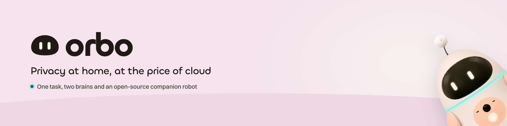

# Who we are

We are a team of robotics researcher and blockchain academic researchers working on robot economic agency since 2016

**Our papers**

- [Robot-Human Agreements and Financial Transactions Enabled by a Blockchain and Smart Contracts](https://dl.acm.org/doi/abs/10.1145/3173386.3177818), HRI 2018
- [Unique Cipher-Acoustic Languages for Human-Robot Interactions](https://ieeexplore.ieee.org/abstract/document/8673114), HRI 2019
- [Robonomics: The Study of Robot-Human Peer-to-Peer Financial Transactions and Agreements](https://dl.acm.org/doi/abs/10.1145/3371382.3380735), HRI 2020
- [AutomataDAO: A Blockchain-Based Data Marketplace for Interactive Robot and IoT Data Exchanges Using Ethermint and State Channels](https://www.springerprofessional.de/en/automatadao-a-blockchain-based-data-marketplace-for-interactive-/18972930) (**on Cosmos**), Blockchain Technologies, Springer, 2021

# The problem

One of the biggest blockers of robots entering the home is the concern over privacy. 60% of users (surveyed among 83 users) brought up privacy concerns because a home robot will need a camera and will move around the home. However, hardware that a good vision model can cost more than the robot itself. So the choice is a cheaper robot where the data is trusted to be handled securely or robot that is twice as expensive for the luxury of privacy. 

# Our solution

We built Orbo, a protocol that gives any robot the privacy of local AI at the price of cloud inference. And to prove it, we built an open-source home robot, Little Orbo.

# Demo

<table>
  <tr>
    <td align="center">
      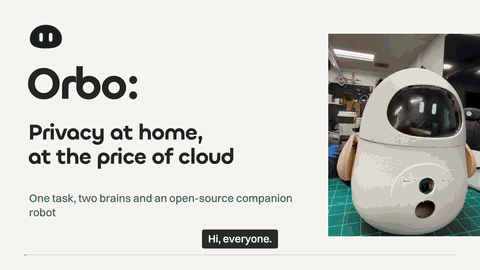<br>
      <sub><b>The Orbo demo in two minutes</b></sub>
    </td>
  </tr>
</table>


# Architecture Diagram

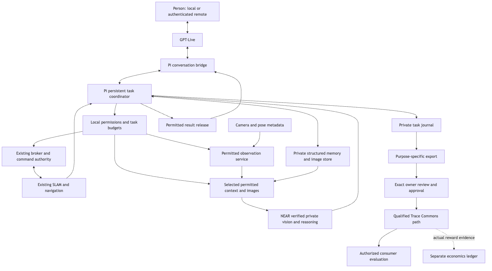


# NEAR integration diagram

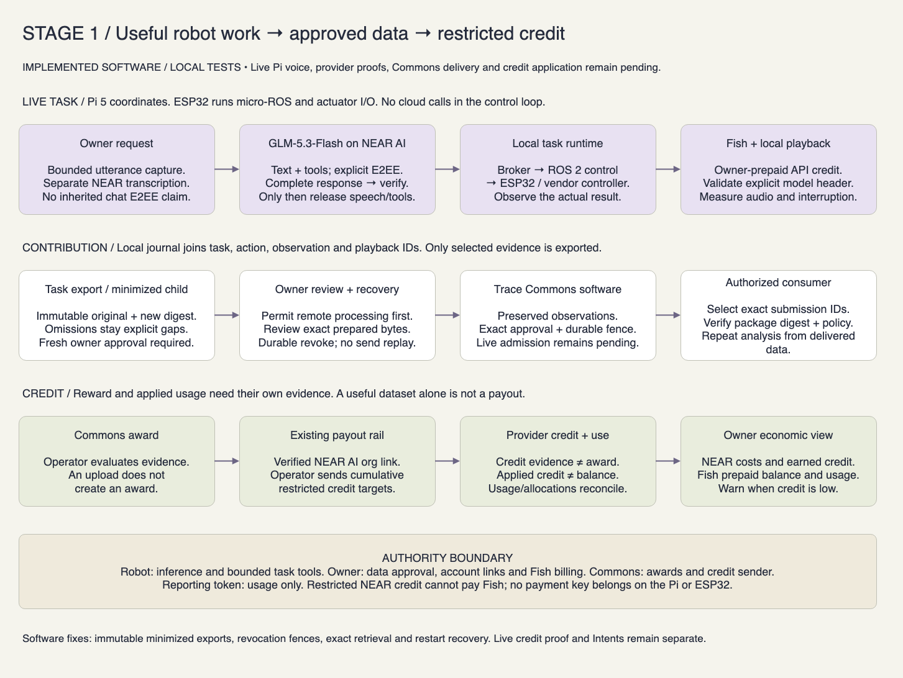

# User Flow

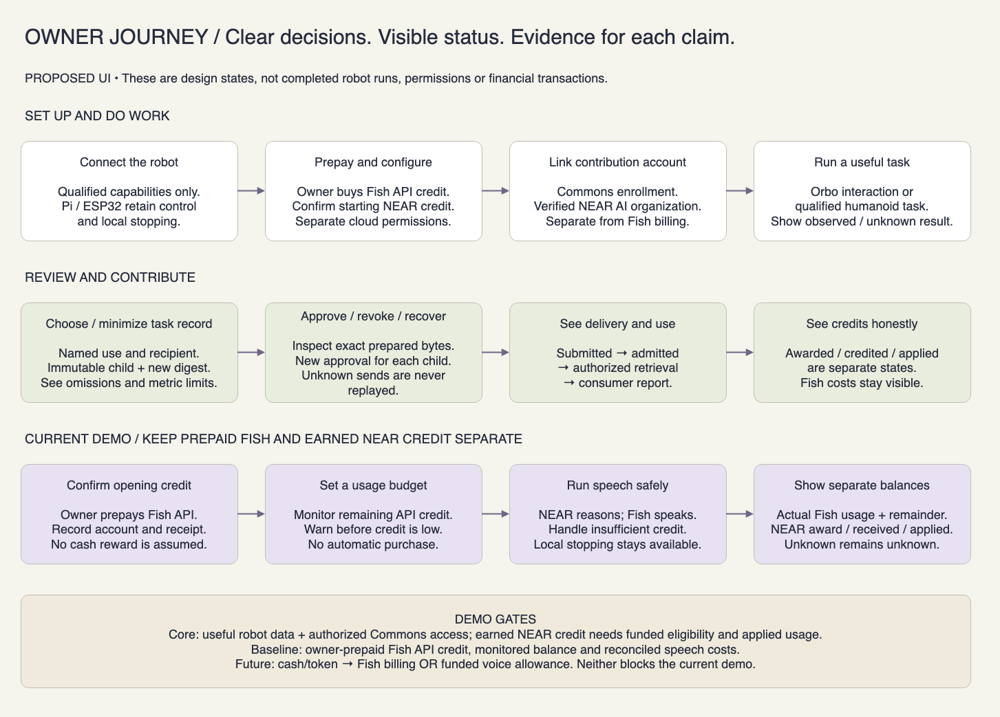

# Orbo Protocol

The Orbo protocol is a set of rules for how a robot shares data with AI models. It works with any robot, not only Little Orbo.

- **Two brains.** A conversation model (GPT-Live) hears, reasons and speaks. A private model (NEAR AI) looks at multi-modal data and reasons.
- **Home data stay private.** Private data of your home go only to NEAR AI. The conversation model receives a short text answer: the action, the location, and the result.
- **You approve what leaves.** No data is shared unless you review and approve it first.

# BOM of Little Orbo

<table>
  <tr>
    <td align="center">
      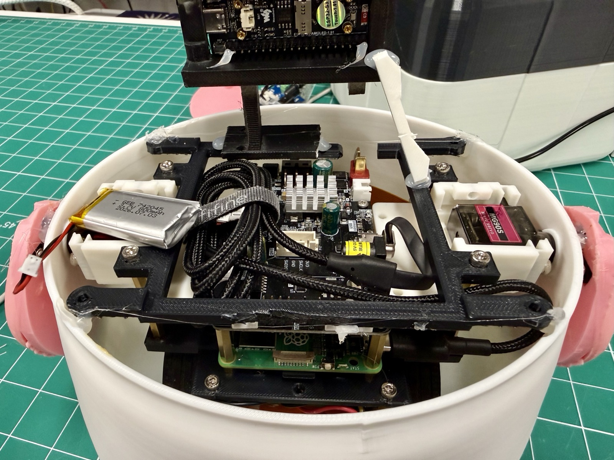<br>
      <sub><b>What's inside Little Orbo</b></sub>
    </td>
  </tr>
</table>

- Raspberry Pi 5
- ESP32 1.9 with display
- Raspberry Pi Camera
- Micro Servos x 2
- Dynamixel
- Buck Converter
- Logic Converter
- Battery 
- and more

# Little Orbo and Booster K1

<table>
  <tr>
    <td align="center">
      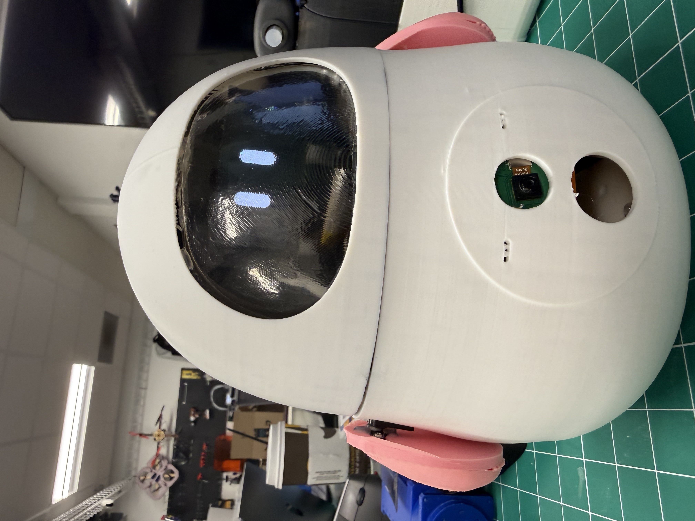<br>
      <sub><b>Orbo v0</b></sub>
    </td>
    <td align="center">
      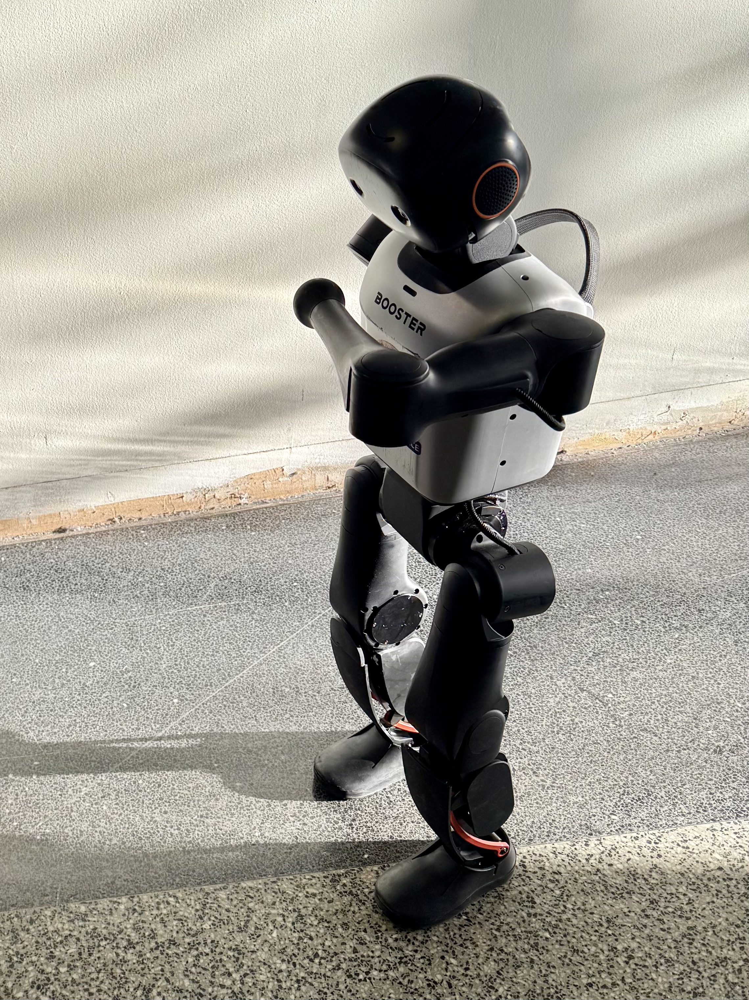<br>
      <sub><b>Booster K1 bowing</b></sub>
    </td>
    <td align="center">
      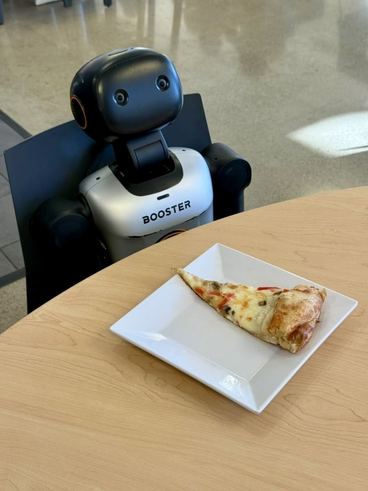<br>
      <sub><b>Robots need pizza too</b></sub>
    </td>
  </tr>
</table>

<table>
  <tr>
    <td align="center">
      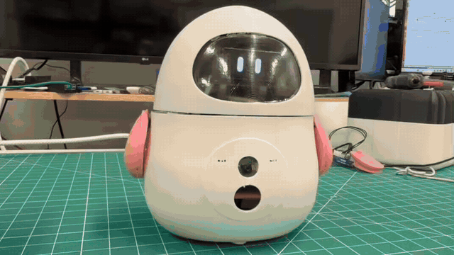<br>
      <sub><b>Orbo on the move</b></sub>
    </td>
    <td align="center">
      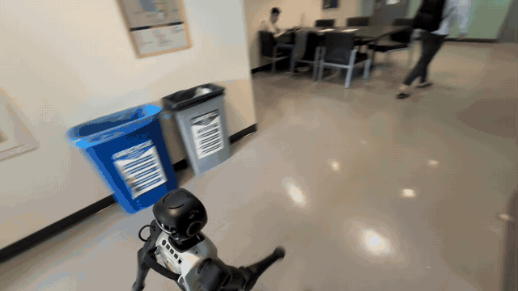<br>
      <sub><b>K1 out for a walk</b></sub>
    </td>
  </tr>
</table>


# Simulation


# Little Orbo target system

The target is Raspberry Pi 5 (8 GB), Ubuntu 24.04 ARM64 / ROS 2 Jazzy, and
ESP32-S3. Native Mac development uses the locked Pixi environment. The host Python
runtime and all six ROS package sources are versioned; deployment archives,
generated evidence and external service installations are separate.

For installation and copy-and-paste hardware checks on the robot, use the
[Raspberry Pi 5 quickstart](PI5_QUICKSTART.md). It uses the Pi's installed
ROS 2 Jazzy and preserves the working camera stack; no Pixi is needed on the Pi.

Start with the [runtime guide](packages/orbo_runtime/README.md),
[ROS workspace guide](ros_ws/README.md), and [firmware README](firmware/orbo/README.md).
Software-only checks do not establish physical driving, Pi peripheral operation,
live-provider behavior or navigation acceptance. Standalone USB/Wi-Fi experiments
live under [prototypes/](prototypes/README.md). The ROS firmware uses its own
bus driver and does not use the prototypes' UDP/text motion handlers.

CAD models, printable STL files, versioned design packages, and ROS mesh exports
are consolidated under [`cad/`](cad/). Version folders retain their supporting
scripts, renders, and validation records. ROS builds install `cad/meshes/v9`
under the existing `orbo_description/meshes/v9` package path.

## Development commands

### Gazebo room simulation on the Mac

For complete setup, launch, navigation, sensor inspection and troubleshooting
instructions, see [SIMULATION_QUICKSTART.md](SIMULATION_QUICKSTART.md).

The native Apple Silicon Pixi environment runs Gazebo Harmonic with Orbo's
v9 model, wheel/caster contacts, lidar and an RGB camera in a furnished living
room. Nav2 uses a supplied map and AMCL to navigate around the furniture.
From this repository, start the room, then send goals in a second terminal:

```bash
pixi run --locked orbo-sim
# Second terminal:
pixi run --locked orbo-sim-goal tour
```

Use `orbo-sim-goal named sofa`, `orbo-sim-goal goal 1.0 -0.55 1.57`, or
`orbo-sim-goal cancel` through `pixi run --locked`. For keyboard driving, start
with `orbo-sim navigation:=false`, then run `orbo-sim-drive keyboard`.
`pixi run --locked ros-test-simulation` checks sensors, goal arrival, cancellation,
physical displacement, command expiry and wall contact in isolated instances.
See the [simulation guide](ros_ws/src/orbo_simulation/README.md) for Mac rendering,
sensor topics, named goals and assumed physics parameters. It does not communicate
with the real robot.

### MacBook ROS 2 / Pixi setup

The locked environment supports **Apple silicon, macOS 14 or newer**, and Pixi
0.84.2 or newer. Use a native ARM64 terminal, outside Rosetta, with no active
Conda, Python virtualenv, ESP-IDF, or other ROS environment. Intel Macs are not
covered by the current lockfile. Install Apple's command-line tools with
`xcode-select --install` if missing. Have either Homebrew or Pixi on `PATH`.

From the repository root:

```bash
./tools/install-ros-macos.sh
pixi run --locked ros-build-interfaces
```

The installer installs Pixi through Homebrew if needed, runs
`pixi install --locked`, and verifies a local ROS 2 C++ publisher/Python subscriber
exchange. It does not communicate with the ESP32. Rerun that check with
`pixi run --locked ros-check`. Use Pixi's Python for `rclpy`; the `uv` environment
below is separate. See the [Mac runbook](docs/engineering/runbooks/ros-macos.md)
for environment troubleshooting and `pixi run orbo-preview` for the RViz model.
Use `pixi run --locked rviz-pi` for the combined remote Pi model, camera,
odometry and coordinate-frame viewer. Its standard ROS entry point is
`ros2 launch orbo_description rviz.launch.py` after sourcing the workspace;
see the [viewer setup](docs/engineering/runbooks/ros-macos.md#combined-pi-viewer-model-camera-odometry-and-frames)
for camera topics and network settings.

### Quick start: Xbox joystick teleoperation

Connect the Xbox controller to the **Mac** by USB or Bluetooth. The Mac publishes
joystick input over the local network; the **Pi** runs Orbo's runtime and ROS
controllers. Left stick drives/steers, and **LB must be held to move**. Release LB
to command zero velocity. The initial mapping uses 25% of calibrated speed limits.

**One-time Mac build**, from this repository:

```bash
cd /Users/kpatch/startup/opendive/projects/little-orbo
pixi install --locked
pixi run --locked ros-build-workspace
```

**Mac terminal 1 — Xbox input (leave running):**

```bash
cd /Users/kpatch/startup/opendive/projects/little-orbo
pixi run --locked bash
source ros_ws/install/macos/local_setup.bash
export ROS_DOMAIN_ID=42 RMW_IMPLEMENTATION=rmw_fastrtps_cpp
export ROS_AUTOMATIC_DISCOVERY_RANGE=SUBNET
unset ROS_LOCALHOST_ONLY
ros2 run joy joy_enumerate_devices
```

Copy the exact Xbox device name from the output into this command:

```bash
ros2 launch orbo_bringup joy.launch.py driver:=game_controller_node \
  device_name:="EXACT NAME FROM ENUMERATOR"
```

**Mac terminal 2 — verify input:** open another Pixi shell, source the same
workspace and set the same environment variables as terminal 1, then run:

```bash
ros2 topic echo /orbo/teleop/joy
```

Check that left-stick movement changes axes 0/1 and LB changes button 9 from 0 to
1 while held. Ctrl-C stops the observer. If enumeration lists no devices, connect
or pair the controller and rerun it before proceeding.

**Pi — prepare and authorize motion:** follow the
[robot startup and session commands](ros_ws/README.md#2-pi-configure-and-start-the-robot)
to configure the Xbox mapping in `/etc/orbo/runtime.toml`, start the agent,
controllers, runtime and one teleop gate, activate the drive controller, and
request a bounded owner session. This requires measured wheel calibration and a
qualified controller mapping. The joystick launch alone publishes input; it does
not activate controllers or arm motors. Keep LB released while requesting the
session, then hold it to drive. Sessions last at most 30 seconds.

**Stop**, from a Pi owner terminal:

```bash
sudo -u orbo /opt/orbo/.venv/bin/orbo request stop
```

Then Ctrl-C the Mac joystick launch. For network troubleshooting, Pi-connected
controllers, and qualification steps, see the full
[Xbox launch guide](ros_ws/README.md#remote-xbox-joystick-control).
The existing lifted-bench keyboard helper below is a separate control path;
stop it before using application teleop.

### Quick start: keyboard control with the updated firmware

With the updated firmware already flashed, keep USB connected, motor power on,
and the base lifted. No rebuild, flash, or B1–GND bridge is needed for this test.
Use two fresh terminals outside ESP-IDF; stop any other wheel-command publisher.

**Terminal 1 — agent (leave running):**

```bash
cd /Users/kpatch/startup/opendive/projects/little-orbo
./tools/run-xrce-agent-macos.sh /dev/cu.usbmodem1234561
```

Use the application CDC0 port; check `ls /dev/cu.usbmodem*` if its name changed.
The agent helper activates Pixi itself. If an agent is already using that port,
keep it running instead of starting a second copy.

**Terminal 2 — keyboard controller:**

```bash
cd /Users/kpatch/startup/opendive/projects/little-orbo
pixi run --locked bash
source ros_ws/install/macos/local_setup.bash
export ROS_DOMAIN_ID=42
export RMW_IMPLEMENTATION=rmw_fastrtps_cpp
python firmware/orbo/bench_tests/control_wheels.py keyboard
```

Wait for `Armed:`. W/S command both wheels positive/negative; A/D command
opposite wheel directions. Space/X requests zero while staying armed. Q or
Ctrl-C stops, disarms, and exits. Default speed is 1.2 rad/s; add `--speed 0.6`
for half speed. After 350 ms without a movement key/repeat, velocity returns to
zero; the operating system's initial key-repeat delay can cause a brief pause.
Expect `Stopped and disarmed (encoder feedback).` on exit, then stop the agent
with Ctrl-C. The helper does not automatically rearm after a fault.

For the 30-second straight-wheel regression, run this in terminal 2 after the
keyboard controller has exited:

```bash
python firmware/orbo/bench_tests/control_wheels.py drive --left 1.2 --right 1.2 --seconds 30
```

See the [firmware instructions](firmware/orbo/README.md#manual-cli-and-keyboard-wheel-control)
for feedback diagnostics and an independent ROS stop command. First-time setup
is above; agent build and additional ROS observers are below.

### Connect the ESP32 micro-ROS firmware to ROS 2

The current firmware `sdkconfig` enables wheel arming for a lifted-base bench
at a 1.2 rad/s maximum; it still boots disarmed and keeps flippers disabled.
The motor bus runs at 115200 baud, with automatic torque-off migration of
known XL430s from the former 1 Mbps profile.
Use the [lifted-wheel test](firmware/orbo/README.md#current-lifted-wheel-test)
for that image, or use [manual CLI/keyboard control](firmware/orbo/README.md#manual-cli-and-keyboard-wheel-control).
Do not run the historical bare-board wheel-arm rejection test
with wheel arming enabled, because that request can enable torque.

For the flashed board, build the native Mac XRCE agent once:

```bash
./tools/build-xrce-agent-macos.sh
ls /dev/cu.usbmodem*
```

This helper enters Pixi itself, fetches locked agent sources, and applies the
macOS Unix-clock synchronization patch. The native bridge is the standalone
**Micro XRCE-DDS Agent**, not the full micro-ROS graph manager used on the Pi.
Test topics directly; `ros2 node list` is not the acceptance check.

Terminal A, from the repository root, starts the agent and stays running:

```bash
# Replace with the actual application CDC0 port on your Mac.
./tools/run-xrce-agent-macos.sh /dev/cu.usbmodem1234561
```

The tested board exposes CDC0 as `/dev/cu.usbmodem1234561` for XRCE traffic and
CDC1 as `/dev/cu.usbmodem1234563` for text logs. Port names can change. The ROM
bootloader port `/dev/cu.usbmodem1301` is for flashing, not the agent. Only one
process may open each serial port.

In **each ROS terminal**, start at the repository root and activate the messages:

```bash
pixi run --locked bash
source ros_ws/install/macos/local_setup.bash
export ROS_DOMAIN_ID=42
export RMW_IMPLEMENTATION=rmw_fastrtps_cpp
```

Terminal B observes health, or actuator acknowledgments when publishing tests:

```bash
ros2 topic echo /orbo/embedded/health orbo_embedded_interfaces/msg/Health \
  --qos-reliability best_effort
# Ctrl-C before switching to the next observer:
ros2 topic echo /orbo/embedded/actuator_status orbo_embedded_interfaces/msg/ActuatorStatus \
  --qos-reliability best_effort
```

Terminal C, with the same ROS environment, can publish a stop:

```bash
ros2 topic pub --once --max-wait-time-secs 10 \
  /orbo/embedded/control_session orbo_embedded_interfaces/msg/ControlSession \
  '{interface_version: 1, operation: 0}'
```

Expect actuator status `state: 5` and health `armed: false`. A CLI "publishing"
message alone is not an acknowledgment. For a deliberately invalid arm request:

```bash
ros2 topic pub --once --max-wait-time-secs 10 \
  /orbo/embedded/control_session orbo_embedded_interfaces/msg/ControlSession \
  '{interface_version: 99, operation: 1, enable_wheels: false}'
```

Expect `state: 4` (rejected). The [firmware README](firmware/orbo/README.md)
includes wheel/flipper rejection examples, fresh software-only arm/stop tests,
bounded telemetry checks, firmware build/flash instructions, and recovery tests.
Stop the agent with Ctrl-C when finished; `exit` leaves each Pixi Bash shell.

For subsequent firmware updates on the Mac, stop the agent and serial monitors,
then use a separate ESP-IDF terminal:

```bash
source .sdk/esp-idf-v6.0.3/export.sh
./tools/build-firmware.sh
./tools/flash-firmware.sh
```

The flash helper requests bootloader entry through the logging USB port, follows
the board into ROM, flashes and verifies the images, and restarts the application.
No B1–GND bridge is needed once the automatic-entry firmware is installed. The
[firmware README](firmware/orbo/README.md#6-firmware-build-flash-and-host-regression-tests)
also covers initial installation and manual recovery. Opening CDC1 at 1200 baud
is reserved for bootloader entry; use 115200 for normal logs.
Generated test reports and hardware captures remain local and are excluded from Git.

### Integrated ROS 2 base control on the Mac

The native Pixi environment includes the controller manager, differential-drive
controller and joint-state broadcaster. See the [Mac control-stack runbook](docs/engineering/runbooks/ros-control-macos.md)
for the build, agent, controller, keyboard and live-RViz commands. This path uses
measured wheel positions for odometry and nominal CAD dimensions for a lifted bench.
Qualify physical driving with raised-wheel tests before ground operation.
Pixi runs natively on macOS; Docker is not required.
After updating, restart existing Pixi shells, the agent, and ROS processes to pick
up the UDP transport configuration. Run from the repository root:

```bash
pixi run --locked ros-test-control         # Full control/fault suite, domain 96
pixi run --locked ros-test-control-repeat  # Five fresh 30-second runs, domain 97
```

Neither command opens USB or needs the battery. The [control runbook](docs/engineering/runbooks/ros-control-macos.md#mac-transport-and-timing)
explains the callback/dispatch fixes, Docker test-process cleanup, and Mac load
limits.

The live description and preview use the complete **v9 assembly**, including
the v8 chassis, flippers and shells plus the v9 display mount. Use the runbook's
internal preview to inspect beneath the shells. Flippers are fixed CAD references;
their physical PWM configuration remains unresolved.

### Runtime and ROS source

The [host runtime guide](packages/orbo_runtime/README.md) explains application
coordination, robot adapters, optional services, and the different keyboard paths.
The [ROS workspace guide](ros_ws/README.md) documents all five packages, global
TF topics, camera/Nav2 launch boundaries, and fresh-checkout setup:

```bash
pixi install --locked
pixi run --locked ros-build-workspace
pixi run --locked ros-test-integrations
```

Pixi installs `orbo-runtime` directly; no `PYTHONPATH` workaround is needed.
The integration tests use synthetic inputs in domain 96. Physical driving and
Pi peripheral/navigation acceptance remain separate. Old v05 meshes and local
generated reports are excluded from source commits. Curated synthetic evidence
is included under `docs/engineering/evidence/`.

For standalone OV5647 camera setup on the Pi, use the
[ROS 2 camera setup guide](deploy/ros2-camera/README.md). Its script checks the
working libcamera installation, builds `camera_ros`, and publishes `/camera/*`
topics for an initial image test.

The [NEAR synthetic vision evidence](docs/engineering/evidence/near-vision/README.md)
contains the exact sample images, ground-truth labels, live model responses and
verification receipts from the Mac recognition test, with offline checks and
instructions to repeat it. The three-scene result does not qualify real-camera
accuracy or robot latency.

### Python application development

The Orbo Python application workflow requires Python 3.12 and `uv`. Run from this repository:

```sh
uv sync --locked --all-extras --group dev
uv run --locked --all-extras pytest -q
uv run ruff check ros_ws/src/orbo_runtime/orbo_runtime tests
uv run --all-extras orbo diagnostics
uv run --all-extras orbo demo --database /tmp/orbo-synthetic.db
cc -std=c11 -Wall -Wextra -Werror -fsanitize=address,undefined \
  -Ifirmware/orbo/main firmware/orbo/main/control.c \
  firmware/orbo/host_tests/test_control.c -o /tmp/orbo-control-test
/tmp/orbo-control-test
```

The demo makes no network or hardware calls. It labels simulated action/playback and preserves its episode and export in SQLite. `uv.lock` pins Python dependencies and package hashes; Pi installation and audio verification remain separate checks.

## Components

| Location | Responsibility |
|---|---|
| `ros_ws/src/orbo_runtime` | SQLite journal, reminders/preferences, broker, conversation/tools, NEAR reasoning, OpenAI Live voice and local audio, ROS adapter, exports and owner CLI |
| `firmware/orbo` | Production micro-ROS application, local command expiry, XL430 feedback/watchdogs and calibrated PWM |
| `ros_ws/src` | Bounded shared embedded interfaces and Pi ROS packages |
| `artifacts/test-evidence` | Ignored local captures; not part of the source distribution |
| `docs/engineering` | Architecture contracts and operator instructions |

Credentials load automatically from the Git-ignored project `.env`; copy the blank [.env.example](.env.example) to initialize it. OpenAI Live is the only voice integration and uses `OPENAI_API_KEY`; NEAR reasoning and vision use `NEARAI_API_KEY`. Deployed services read `/opt/orbo/.env` through systemd. Cloud processing, local execution, speech and contribution permissions are distinct and default to absent.

Firmware boots disarmed. Generic Kconfig defaults disable wheel and flipper commissioning; the checked-in `sdkconfig` selects the wheel-enabled lifted-base bench profile described above. Flipper pins and pulse limits remain unset and flippers stay disabled. Ground driving and navigation still require physical qualification. The runtime includes clients for a separate Booster K1 worker and Commons service;
those services and their deployment assets are not installed by the Python or
Pixi setup above.

Build the Python distribution with `uv build`; local outputs go to ignored
`dist/`. Use the [workspace guide](ros_ws/README.md) for camera/teleop/navigation
launch integration and its Pi validation boundary. The current Mac bench setup
is documented in the [control runbook](docs/engineering/runbooks/ros-control-macos.md).

## Private cloud validation

Initialize credentials without overwriting existing values, then prepare the
[E2E configuration and recorded inputs](deploy/live-e2e/README.md):

```bash
uv run --frozen orbo credentials init
uv run --frozen orbo credentials status
uv run --frozen --extra near --extra live orbo live-e2e preflight --config .live-validation/e2e/config.json
```

Edit only the project `.env` for real keys. Preflight makes no provider calls.
The Live E2E runner tests OpenAI Live with NEAR delegation; live execution requires
explicit flags for cloud calls, tasks and exports as applicable. Reports stay
under ignored `.live-validation/`. For physical microphone/speaker commissioning,
follow the [Live audio guide](deploy/audio/README.md).
