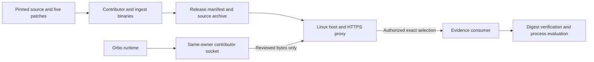

# Deploy the Orbo-compatible Trace Commons integration

For a loopback instance that needs no external account or provider key, use the
[synthetic local contribution/retrieval setup](local-development.md). It exercises
the real contributor, local signing issuer, ingest and consumer. The production
configuration below remains a separate qualification path.

This setup builds the **pinned, patched contributor and open ingest server**, records executable provenance, supplies Linux services, and checks a deployed server's identity and exact evidence delivery. Nothing enrolls a device, changes consent, approves a trace, transfers funds, or deploys remotely automatically. These instructions target an operator-controlled instance that agrees to the `orbo.task-evidence.v1` contract and provenance-marked Feedback carrier.

The upstream open build does **not** contain the proprietary production Score, settlement or payout adapters. A passing health check cannot establish admission, rewards, received credit, or applied usage. A production operator must supply those components if the intended deployment requires them. The packaged open server is useful for the supported ingest/review/export API; it must not be represented as the complete commercial rewards service.



## Build and package

On each target OS/architecture, install Rust 1.96.0 and native build prerequisites from the pinned upstream source. Build natively; a macOS package is not a Pi/Linux executable. For Linux, use Ubuntu 24.04 and a current C/C++ compiler. The default has no GPU/GCS/KMS feature assumptions; those operator-specific features require a separately qualified build, not changing the manifest after compilation.

```sh
python3 tools/package-commons.py \
  --output artifacts/commons-release-linux-arm64 --profile release
```

The command verifies the ordered five-patch series using `bootstrap-commons.py`, builds both binaries with `--locked`, stamps revision plus patch digest, verifies each executable's `--version`, runs the ingest TLS self-check, and publishes the release directory only after success. `--profile debug` supports local process smoke testing. Cargo output is isolated in the verified source checkout's `target` to avoid mixed workspace artifacts. The manifest records hashes, compiler/host, source identity, build profile and features. A failed build never creates a completed release directory.

The package includes `bin/`, `manifest.json`, `source.tar.gz`, and `deployment/`. The source archive contains tracked source plus declared patched files, including the lockfile and licensing; it excludes the Git database, credentials, targets and other untracked files. It is the corresponding modified source for the packaged binaries. Publish that exact archive alongside the service. Keep deployment evidence and generated packages in ignored `artifacts/`, not in Git.

## Install server files

Use a fresh release directory and retain the previous one for rollback. Verify manifest hashes before installation:

```sh
python3 tools/package-commons.py --verify artifacts/commons-release-linux-arm64
```

This checks every packaged file without executing it. Transfer the manifest through a trusted channel; hashes detect corruption, not an attacker replacing both manifest and binaries. On the server, create a dedicated `tracecommons` system user and copy `bin/` to `/opt/trace-commons/bin/`. Install `trace-commons-ingest.service` under `/etc/systemd/system/` and place a root-owned, mode-0600 completed `ingest.env` at `/etc/trace-commons/ingest.env`. The service listens on loopback and creates its private data/cache directories through systemd. Do not expose port 3907 publicly.

Both native service units use `/opt/orbo/.venv/bin/python -m orbo_runtime.commons_credentials`, so install the Orbo runtime Python package on the Commons host as well as on the robot. All user-supplied API credentials and database secrets live in the **Git-ignored project `.env`** described by the [deployment README](../README.md). The services use `LoadCredential=orbo.env:/opt/orbo/.env` and the nonsecret pointer `/opt/orbo/deploy/credentials.service.toml`; systemd supplies an ephemeral per-service copy without granting the `tracecommons` user access to other services' state. Keep `/opt/orbo/.env` root-owned, mode 0600. Do not put secrets in `ingest.env`, unit files, `.env.example`, other tracked files, or daemon settings.

The ingest service needs `DATABASE_URL`, `TRACE_COMMONS_LOGIN_RESOLVER_DATABASE_URL`, and `TRACE_NEAR_AI_PRIVACY_API_KEY` in that shared file, plus any configured issuer/operator secrets under their native `TRACE_COMMONS_*` names. The contributor receives only the selected privacy-classifier settings; it does not inherit ingest administrator, database, wallet or OpenAI secrets. Both services read the file automatically at launch; restart them after rotating credentials.

Complete the example using the **pinned source's** `docs/operator/deployment.md`, `docs/operator/env-reference.md`, and `docs/operator/login-resolver-role.md` included in `source.tar.gz`. Required external dependencies are the managed EdDSA issuer, PostgreSQL migrations and least-privilege roles, tenant policy and access grants, enrollment/login configuration, and a functioning privacy filter. The environment template includes the pinned NEAR privacy classifier backend, endpoint, model and request limits; provide `TRACE_NEAR_AI_PRIVACY_API_KEY` for that classifier. Object storage/KMS and model/scoring configuration depend on the chosen operator deployment. The sample deliberately refuses to boot with placeholders or missing privacy filtering; it does not silently substitute test authorization or fake scoring.

Configure HTTPS on the operator's reverse proxy and include `nginx.conf.example` inside its HTTPS `server` block. Publish the release's `source.tar.gz` at `/opt/trace-commons/public/source.tar.gz`. Create `/opt/trace-commons/public/source-offer.json` with:

```json
{
  "license": "AGPL-3.0-or-later",
  "source_url": "https://YOUR_COMMONS_HOST/orbo-commons-source.tar.gz",
  "build_commit": "COPY_EXACT_BUILD_COMMIT_FROM_MANIFEST",
  "build_version": "0.1.0"
}
```

This explicit source route replaces upstream's unmodified-source URL and serves the actual patched source. Verify both public URLs. Start only after configuring the dependencies:

```sh
sudo systemctl daemon-reload
sudo systemctl enable --now trace-commons-ingest
sudo journalctl -u trace-commons-ingest --since today
```

For rollback, stop the service before replacing binaries. Preserve data, database migrations and deployment configuration; an older server may not understand newer storage. Never roll a contributor containing permanent revocation fences back to an unpatched build.

## Configure the owner-local contributor

The contributor and Orbo runtime must run as the **same UID**. The runtime validates both socket and directory ownership/mode; sharing a group does not suffice. The supplied service assumes the runtime's `orbo` user and `/var/lib/orbo/commons/daemon.sock`.

```sh
sudo install -d -o orbo -g orbo -m 0700 /var/lib/orbo/commons
# First installation only. Do not replace an existing daemon-settings.json.
sudo install -o orbo -g orbo -m 0600 \
  deploy/trace-commons/daemon-settings.json.example \
  /var/lib/orbo/commons/daemon-settings.json
```

The example explicitly disables discovery of unrelated coding-agent sessions, telemetry and proxy body capture. Only files deliberately placed in the contributor staging folder are observed. Normalized trajectories remain manual-review-only in the patched watcher. Inspect existing settings before upgrades; do not reset an existing owner's choices.

Put the intended instance's invite in `TRACE_COMMONS_INVITE` in the same project `.env`. Enrollment is an explicit one-time operation; starting the daemon service never enrolls it. On the installed Linux host, run the wrapper with the same systemd credential source:

```sh
sudo systemd-run --wait --pipe --collect \
  --property=User=orbo --property=Group=orbo --property=UMask=0077 \
  --property=LoadCredential=orbo.env:/opt/orbo/.env \
  --setenv=ORBO_CREDENTIALS_CONFIG=/opt/orbo/deploy/credentials.service.toml \
  /opt/orbo/.venv/bin/python -m orbo_runtime.commons_credentials login \
  --binary /opt/trace-commons/bin/trace-commons-contributor \
  --config-dir /var/lib/orbo/commons --issuer-host YOUR_ISSUER_HOST
```

For local development, `uv run python -m orbo_runtime.commons_credentials login --binary PATH_TO_NATIVE_CONTRIBUTOR --config-dir OWNER_PRIVATE_DIRECTORY --issuer-host YOUR_ISSUER_HOST` discovers the repository's public credential pointer automatically. The wrapper requires the selected invite, passes only that enrollment credential, fixes consent to `debugging_evaluation`, and preserves existing enrollment. It cannot fall back to the default NEAR browser login. The native issuer consumes the invite; run once.

For supported headless account linking, put the one-time `TRACE_COMMONS_DEVICE_CODE` in the shared file and replace `--issuer-host YOUR_ISSUER_HOST` with `--device-code`. This route requires the same-owner unenrolled contributor daemon already running. The native CLI reads the selected code from its environment; neither the code nor invite is placed in argv. Do not combine these options: native device-code login conflicts with issuer-host selection. Enrollment credentials are excluded from normal ingest and contributor service environments. Do not invent `config.json` credentials or reuse a consumer exporter token as contributor enrollment.

The launcher reads `TRACE_NEAR_AI_PRIVACY_API_KEY` from the shared external file and selects the native protocol redactor's `TRACE_PRIVACY_FILTER_BACKEND=near-ai` support. It supplies the documented classifier endpoint/model defaults unless the shared file specifies `TRACE_NEAR_AI_PRIVACY_BASE_URL` or `TRACE_NEAR_AI_PRIVACY_MODEL`. No API key is written into contributor state, and no enrollment/device/queue files are copied or replaced.

Leave enrolled `config.json`'s `pii_filter` field unset/null and `daemon-settings.json`'s `near_ai` field unset/null. Those older selectors require or override with a second persisted key source, so the launcher refuses them. If transitioning from the earlier setup, stop the daemon, remove only those fields while preserving enrollment, consent and all other settings, then restart. Both files remain owner-private, mode 0600. The effective privacy filter is still required by the launcher: a missing shared classifier key fails startup, and an invalid native filter configuration fails closed.

Preview/review of an enrolled trace can send its prose to the configured NEAR privacy classifier. Use the explicit review permission and inspect the recipient before proceeding; selecting environment-backed credentials does not authorize a trace upload. The classifier credential remains distinct from the runtime's NEAR reasoning key and the consumer's export token. Install `orbo-commons-contributor.service`, then start it. Set this fragment in the Orbo runtime's selected TOML profile:

```toml
[commons]
socket = "/var/lib/orbo/commons/daemon.sock"
origin = "https://YOUR_COMMONS_HOST"
account = "YOUR_ACCOUNT_LABEL"
```

Retain explicit runtime review/contribution/retrieval grants. Creating an export does not authorize uploading it. Use the runtime's stage → preview → review → exact-digest approval workflow. A result whose send status is uncertain must be reconciled, not submitted again blindly.

## Check readiness and delivery

First validate local configuration without networking:

```sh
uv run --frozen python tools/check-commons-deployment.py \
  --origin https://YOUR_COMMONS_HOST \
  --manifest artifacts/commons-release-linux-arm64/manifest.json
```

Add `--allow-network` to verify public `/health` and its exact build identity. Run as the contributor/runtime user with `--socket /var/lib/orbo/commons/daemon.sock` to also verify enrollment and the patched IPC methods. The report keeps setup completion, paused state and terms hold separate from health.

After a deliberately approved trace is actually accepted, put `COMMONS_EXPORT_TOKEN` in the same project `.env` and add `--submission-id UUID --digest REVIEWED_EXPORT_SHA256 --purpose embodied_process --privacy-risk low`. This checks the authenticated custom endpoint, exact selection acknowledgement, reconstruction and the exact reviewed package digest. It does not return trace content or tokens. Missing admission or incompatible delivery fails the check; public health alone cannot pass it. Exporter authorization must include the selected tenant, purpose and debugging-evaluation consent scope.

Use the live E2E runner for the upstream task and review/approval stages. Consumer delivery is process evidence; image artifact transport and independent visual outcome scoring are not established by text/event delivery. Rewards and credits require separate authoritative receipts and reconciliation.

## Local process smoke without provider keys

After a native debug or release package build:

```sh
uv run --frozen python tools/smoke-commons-processes.py \
  --release artifacts/commons-current-macos-arm64
```

The tool verifies package hashes, starts both real binaries against temporary state, requires the stamped server health identity, proves unauthenticated custom export is denied, checks authorized exact-selection acknowledgement for an empty dataset, and inspects the owner-private daemon IPC methods. It uses a generated local export token and an unenrolled dry-run contributor with all unrelated sources disabled. No provider/account credentials are inherited. Both processes are terminated and temporary state is removed on success, failure or timeout. Enrollment, trace upload, accepted delivery, privacy-model behavior and commercial rewards remain explicitly untested by this smoke; use the credentialed live runner for those applicable stages.
