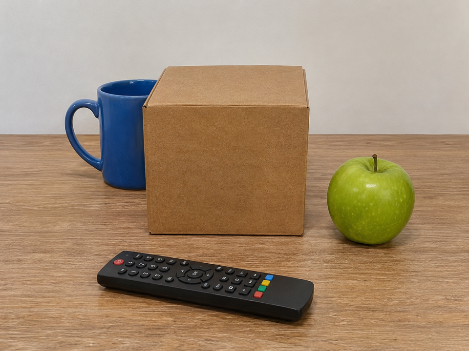
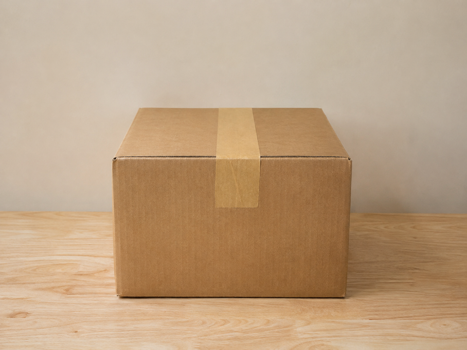

# NEAR vision: synthetic Mac test evidence

The live `z-ai/glm-5.3-flash` model identified all **eight labeled object
instances across three synthetic scenes**, with correct colors and counts.
It recognized the partly occluded mug and declined to invent the contents of
a sealed box. These are saved results from real NEAR calls, not fixture-backed
provider responses or a representative accuracy benchmark.

| Scene | Ground truth | Result | Request duration |
|---|---|---|---|
| Clear objects | Red mug, blue book, yellow banana; one each | 3/3; correct left/right arrangement | 8.776 s |
| Partial occlusion | Blue mug, brown box, green apple, black remote; one each | 4/4; mug occlusion recognized | 48.917 s |
| Sealed box | One brown cardboard box; contents unobservable | 1/1; contents correctly left unknown | 5.780 s |

Durations include SDK verification and inference. The test used a 120-second
timeout. The occlusion request exceeded the adapter's default 40-second timeout;
this result does not qualify robot response latency.

## Images and actual model answers

These are the **exact 960 × 720 PNG bytes submitted to NEAR**. The images contain
no answer labels. Ground truth is stored separately in [labels.json](labels.json)
and was visually checked before inference. Its original hash is retained in
[manifest.json](manifest.json).

### Clear objects


The model returned one `mug` / `red`, one `book` / `blue`, and one `banana` /
`yellow`, all fully visible. Exact relationship statements:

> The mug is to the left of the book.
>
> The banana is to the right of the book.

[Complete answer, usage and verification receipt](responses/scene-01-response.json).

### Partial occlusion



The model returned one `mug` / `blue`, one `cardboard box` / `brown`, one `apple`
/ `green`, and one `remote control` / `black`. Exact relationship statements:

> The mug is to the left of the box and partly hidden behind it.
>
> The apple is to the right of the box.
>
> The remote control lies in front of the box.

The mug's visibility was `partially occluded by the box`. A minor wording issue
remains: the response says the handle points toward the “left wall”; only the
image-left direction is established. This was not counted as an extra object.

[Complete answer, usage and verification receipt](responses/scene-02-response.json).

### Sealed box



The model returned one `cardboard box` / `brown`, centered and closed. Its exact
answer about hidden contents:

> The box is closed and sealed, so its contents cannot be determined from the image.

[Complete answer, usage and verification receipt](responses/scene-03-response.json).

## Method and evidence inventory

- Images were produced with built-in imagegen using the exact
  [generation prompts](generation-prompts.json). They were resized with
  `sips --resampleHeightWidth 720 960`; the original generated images are local
  artifacts, while the actual test inputs are included here.
- Each image was sent in an independent request with the same
  [inference prompt](inference-prompt.json). Labels, generation prompts, previous
  answers and expected object counts were not sent to the model.
- The [runner](../../../../tools/vision-e2e.py) used the production
  [NearReasoner](../../../../ros_ws/src/orbo_runtime/orbo_runtime/providers.py),
  `nearai-inference-sdk==0.3.0`, E2EE enabled, and its default verification policy.
  There were no automatic retries or model fallbacks. No robot was connected.
- Each answer passed the SDK's live response verification with signature kind
  `provider_tee`. The saved receipts retain the signed hash string, Ed25519
  signature, public signer key, verification timestamp, TCB status, runtime
  measurements and compact attestation summaries.
- [assessment.json](assessment.json) records object matching, manually reviewed
  spatial relationships, the wording issue, latency and limitations. Reported
  usage totaled 3,132 prompt tokens and 1,210 completion tokens (4,342 total).
  This is provider-reported usage, not a billing reconciliation.
- [manifest.json](manifest.json) lists the size and SHA-256 of every evidence
  asset. Each response also retains its submitted-image hash and the hash of
  the original local response record.

Model answer strings, parsed answers, usage, signatures and durations are
preserved. Machine-local paths were replaced with bundle-relative paths.
Large deployment manifests and duplicated attestation objects were omitted;
their summaries and deployment hashes remain. No API keys, authorization
headers, private account configuration or real camera captures are included.

The receipts record successful verification **at request time**. The offline
check verifies the signature over the recorded hash string using its saved
public key. It does not rerun the complete TEE attestation trust chain or
independently reconstruct the encrypted request/response bytes from the saved
plaintext answers. It also does not establish a separately pinned deployment
policy. Do not treat this bundle as a complete offline attestation replay.

## Verify the saved evidence without cloud calls

From the repository root:

```sh
uv run --frozen --extra near python tools/vision-e2e.py --check-evidence
```

This needs no API key and makes no provider calls. It checks the ten asset hashes,
the original label hash, PNG constraints, response/image associations, parsed
answer consistency, object names/colors/counts, and all three Ed25519 signatures.
Expected output includes `status: passed`, `objects_matching_labels: 8`,
`ed25519_signatures_verified: 3`, and `network_requests: 0`.

The hash manifest detects accidental changes; its own integrity depends on the
repository revision being trusted. Saved answers are historical observations,
not predictions of what another live request will return.

## Repeat the live test

Put an authorized, funded NEAR Cloud key in `NEARAI_API_KEY` in the ignored root
`.env`, then run:

```sh
uv run --frozen --extra near python tools/vision-e2e.py --allow-cloud
```

The default input is this checked-in bundle. New answers go to an ignored
`artifacts/vision-e2e/run-*/` directory and never replace the archived evidence.
`--directory PATH` selects another fixture directory; `--output PATH` selects a
different run-output root. The live command requires `--allow-cloud` because it
incurs provider usage. Review new answers against the labels before making an
accuracy claim; its success exit code establishes transport/verification only.

## Scope still untested

This test does not establish real-camera accuracy, low-light performance,
video tracking, motion tolerance, localization, distance estimation, navigation
safety or exact identity of similar-looking objects. It tests the provider
adapter directly, not the complete observation/task/memory runtime. Three
selected scenes are too few to estimate deployment accuracy or latency
percentiles. Real camera frames and a broader labeled evaluation remain needed.
