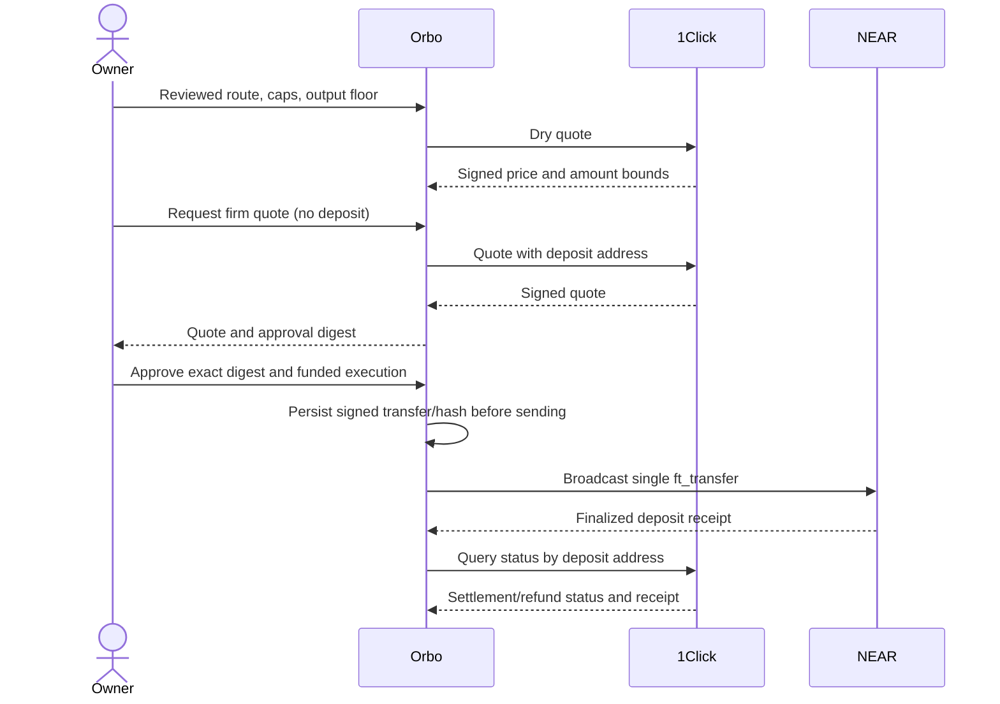

# Explicit NEAR Intents swaps

Orbo supports a restricted 1Click `EXACT_INPUT` swap: a NEAR mainnet NEP-141 token is transferred from an owner-controlled account to the signed quote's deposit account. The destination is any supported 1Click asset on its destination chain, with a recipient fixed in the owner-reviewed policy. Refunds return to the source NEAR account. The origin is checked against the current token catalogue. For `wrap.near`, fund the wallet with **wNEAR tokens** as well as native NEAR for gas; automatic wrapping is not performed.

This is a separate operator command, not a voice/model tool or automatic treasury. It does not purchase provider credits, withdraw Commons awards, claim swaps are payments to a provider, or turn restricted inference credits into tokens. Those flows require a supported payout/funding endpoint and separate authorization. No Intents keys or funds are required for ordinary runtime tests.



## Setup and network-free preflight

Install `uv sync --frozen --extra intents`. Copy [policy.example.json](policy.example.json) to an owner-controlled location and edit **every monetary and account choice**. The sample uses one wNEAR maximum input, a cumulative one wNEAR ceiling, one USDT minimum output, 50 basis points slippage, and a five-minute deadline. It is an example, not a recommended exchange rate or funded permission. All amounts are strings in the asset's smallest units. `max_total_input` applies to all prepared deposits in the persistent journal, including failed or refunded attempts; it is deliberately conservative.

```sh
uv run --frozen --extra intents orbo intents \
  --policy "$HOME/.config/orbo/intents-policy.json" \
  --database "$HOME/.local/state/orbo/intents.db" preflight
```

`preflight` validates the policy without contacting a service. Use the same database for every run; do not rotate or delete it to bypass the cumulative cap or an unresolved transfer. It is created with owner-only permissions. One database and one dedicated signing key/account must have a single operator; do not share that key with another wallet sender or run it against separate databases. Process locking protects concurrent invocations against the same journal.

Optionally inject `NEAR_INTENTS_API_KEY` from your local secret manager for authenticated partner access. Unauthenticated quotes are supported by the API with its corresponding fee schedule. Never put secrets in the policy or command-line arguments. Both the 1Click host and NEAR mainnet RPC host are fixed; redirects are rejected and response sizes/timeouts are bounded.

## Quote, review and execute

Dry quotes contact 1Click but do not produce a deposit address or move money:

```sh
uv run --frozen --extra intents orbo intents \
  --policy "$HOME/.config/orbo/intents-policy.json" \
  --database "$HOME/.local/state/orbo/intents.db" \
  quote --amount 1000000000000000000000000
```

Add `--firm` to request a deposit address for review. Inspect `quote`, `policy`, `expires`, `id` and `approval_digest`; a firm quote still does not sign or deposit anything. Platform fees are reflected in the signed output amounts; the owner-approved minimum output constrains net proceeds. Signature verification follows the official TypeScript SDK's signed-field selection and pinned manager public key. A manager-key rotation fails closed until reviewed and updated in code.

For an explicitly approved funded test, install the NEAR account's Ed25519 key as an owner-only `0600` regular JSON file outside the repository, with `account_id`, `public_key` and `private_key` in standard NEAR key-file format. The account must have native gas balance and source token balance. Use a separately funded account: NEP-141's attached one yoctoNEAR requires a full-access key. The implementation permits only a single `ft_transfer` with one yoctoNEAR and at most 30 Tgas, checks source token balance and deposit-account storage registration, and never adds a storage-deposit or other contract action. Native gas expense is additional to the input-token cap.

Only after reviewing the concrete quote, run:

```sh
uv run --frozen --extra intents orbo intents \
  --policy "$HOME/.config/orbo/intents-policy.json" \
  --database "$HOME/.local/state/orbo/intents.db" \
  execute SWAP_ID --approve EXACT_APPROVAL_DIGEST --allow-funded \
  --key-file /path/outside/repository/near-key.json
```

`show SWAP_ID` reads the retained record. `cancel SWAP_ID` invalidates a quote only before a transfer has been prepared; it does not claim to cancel an on-chain transaction or refund money. Quote changes, policy changes, missing approval, expiry, invalid signatures, unsupported memo routes, absent storage registration and breached caps all fail before broadcasting.

## Recovery and settlement

The signed transaction and its hash are committed before the first broadcast. If the RPC response is lost, the record remains uncertain. Repeating an authorized execution before expiry can only rebroadcast those exact bytes; it cannot sign a new deposit. An unresolved deposit blocks preparation of another swap. Never delete the record or manually submit another transfer to compensate for a timeout.

```sh
uv run --frozen --extra intents orbo intents \
  --policy "$HOME/.config/orbo/intents-policy.json" \
  --database "$HOME/.local/state/orbo/intents.db" \
  status SWAP_ID --key-file /path/outside/repository/near-key.json
```

`status` is a bounded single query, not an unbounded poll. The optional key allows an additional read-only query for the existing deposit's finalized outcome; it does not sign or broadcast. It remains usable after quote expiry. Without a key it queries 1Click settlement only. `SUCCESS`, `REFUNDED` and `FAILED` are recorded separately from NEAR deposit finality, with the returned settlement details. The returned original quote must pass signature verification and match the exact reviewed quote; mutable settlement status itself is a TLS-authenticated API observation, not a signed blockchain proof. A refund is recorded only when reported by the service, never inferred from timeout. A failed or permanently unknown transaction requires operator reconciliation; there is no automatic new-nonce replacement. Read-only receipts are stored in the separate swap journal, not conflated with provider-credit accounting.

## Testing and protocol references

`uv run --frozen --extra intents pytest -q tests/test_intents.py` exercises signature tampering, approval/cap checks, cancellation, uncertain-send restart recovery, duplicate prevention, expiry, refund reconstruction, endpoint response limits and the restricted signer. Serialization and quote hashing have independent golden vectors generated with `@near-js/transactions@2.5.1` and `@defuse-protocol/one-click-sdk-typescript@0.1.26`; ordinary tests require no Node installation or network.

A public token-catalogue request and unfunded dry quote were exercised during implementation; the live quote signature verified and no deposit address was issued. This uncovered HTTP 201 quote responses, millisecond deadline normalization and default platform fees, now covered by regression tests. Funded transfer, destination delivery, refunds and account permissions still require owner-provided credentials and a separately approved transaction. There is no claim that a mock test establishes those outcomes.

Primary references: [1Click flow](https://docs.near-intents.org/integration/distribution-channels/1click-api/quickstart/making-a-request), [quote API](https://docs.near-intents.org/api-reference/oneclick/request-a-swap-quote), [signature verification](https://docs.near-intents.org/integration/distribution-channels/1click-api/verify-quote-signature), [status API](https://docs.near-intents.org/api-reference/oneclick/check-swap-execution-status), [NEAR transaction RPC](https://docs.near.org/api/rpc/transactions), and [NEP-141 transfer requirements](https://docs.near.org/primitives/ft/standard).
