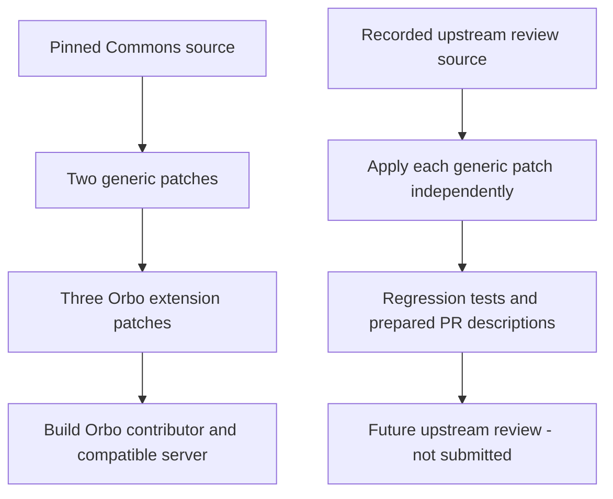

# Trace Commons patch integration

**Patched runtime packaging available (2026-11-14).** The [generic patches](patches/generic/), [Orbo patches](patches/orbo/), ordered [series manifest](patches/series.json), tests and [upstream review packet](upstream/README.md) remain the source baseline. The [deployment README](../../deploy/trace-commons/README.md) now covers packaging both binaries, verified executable identities, corresponding source publication, Linux services, enrollment and deployment checks. A fresh macOS ARM64 debug package was built and verified locally; it is not a Linux/Pi release or a deployed service. Earlier archives retain their own provenance.

The patch-based build is retained. `patches/series.json` is the authoritative application order: **two generic contributor fixes, followed by three Orbo extensions**. The generic patches are independent upstream review candidates; the Orbo patches are not part of those proposed PRs. No PR has been opened, no source pushed, no account enrolled and no service deployed.

The production integration remains pinned to `UPSTREAM_REVISION` (`8fcb9e6`, contributor 1.0.7). `PR_BASE_REVISION` records the separately inspected upstream review base (`279f104`, contributor 1.0.8). Reviewing against current upstream does not silently upgrade the Orbo deployment.

## Files and ownership

| Patch | Purpose | Upstream boundary |
|---|---|---|
| `generic/0001-preserve-trajectory-observations.patch` | Preserve recognized trajectory observations through envelope conversion and normal redaction; include generic regressions and documentation. | Client/source bug-fix proposal. Uses the existing Feedback carrier with a provenance marker; reviewer must agree with this interpretation. |
| `generic/0002-approve-exact-reviewed-envelope.patch` | Approve one entry only if the reviewed digest still matches under the approval lock; include malformed/stale/unpinned/state-change regressions and API documentation. | Independent client approval proposal; ordinary approve stays unchanged. |
| `orbo/0001-task-preparation-fixture.patch` | Prepare a complete synthetic Orbo task for the consumer/server fixture. | Product integration test. |
| `orbo/0002-authorized-task-event-delivery.patch` | Add `/v1/datasets/task-evidence` and `orbo.task-evidence.v1` through existing authorization, consent, risk, retention and auditing gates. | Custom server contract, not offered as a generic fix. |
| `orbo/0003-recovery-and-targeted-evidence.patch` | Permanent `orbo_revoked` fences, exact-entry status/recovery, minimized fixture and selection-before-limit with `X-Orbo-Task-Selection`. | Product extension. General revocation/export APIs need a separate design proposal; renaming them alone would not make them upstream-ready. |

The original six-file bundle maps to the new layout as follows:

| Previous files | New location |
|---|---|
| `0001` regression + `0002` observation fix | `generic/0001` (test and fix together, product-neutral) |
| `0003` exact approval | `generic/0002` (with expanded regressions and API documentation) |
| `0004` task fixture | `orbo/0001` |
| `0005` event delivery | `orbo/0002` |
| `0006` recovery/selection | `orbo/0003` |

Both generic patches apply independently to the recorded pinned and review bases. The full Orbo series requires both generic patches first, followed by the three extension patches in manifest order. New tests/documentation and Rust formatting replace the old six-file packaging; existing Orbo IPC names, schemas, policy checks and recovery behavior are preserved.



## Build and package the full series

From the little-orbo root:

```sh
python3 tools/package-commons.py \
  --output artifacts/commons-release-native --profile release
python3 tools/package-commons.py --verify artifacts/commons-release-native
```

The packager builds both the contributor and open ingest server with the locked dependencies, checks their stamped identities and the server's TLS initialization, and publishes a manifest, hashes and corresponding patched source archive. Build natively on the intended deployment OS/architecture. `--profile debug` supports local process smoke testing. These commands do not install services, enroll accounts or upload traces. For a contributor-only development build, `./tools/build-commons.sh` remains available.

Both build tools default to `.sdk/commons-orbo`. Bootstrap verifies the exact source revision, explicit patch order, patch digest and all modified-source hashes. It refuses missing, duplicate, unlisted or unsafe patch paths and refuses to overwrite changed checkouts. If patch application fails, it reverses only patches applied in that invocation to the initially clean checkout. It never resets an existing modified checkout.

Older `.sdk/commons-locked`, `.sdk/commons-review-fixes` and `.sdk/commons-selector-final` directories are preserved historical checkouts, **not the default build input**. Do not mix patch generations. For a future changed series, select a fresh directory:

```sh
ORBO_COMMONS_SOURCE="$PWD/.sdk/commons-next" ./tools/build-commons.sh
```

The build stamps the pinned revision and ordered patch digest into the executable. A generic-only build is not an Orbo-compatible replacement: Orbo recovery and task delivery require the extensions. Do not downgrade a daemon queue containing permanent revocation fences.

## Review the generic fixes separately

```sh
# Generic fixes against the existing integration pin:
python3 tools/bootstrap-commons.py --profile generic
# The same patches against the explicitly recorded upstream review revision:
python3 tools/bootstrap-commons.py --profile generic \
  --directory .sdk/commons-upstream-review \
  --revision "$(cat integrations/trace_commons/PR_BASE_REVISION)"
```

See [upstream review packet](upstream/README.md) for independent-patch commands, PR descriptions, verification evidence and maintainer decision points. The `.patch` files remain the maintained source of edits; a future PR branch is created by applying one patch and committing the result. After an upstream fix is merged and the integration pin advances past it, remove the corresponding patch from the manifest and revalidate the full series. Never apply a patch again on top of an upstream revision already containing it.

## End-to-end behavior and acceptance

The ordinary contributor parser/redactor prepares approved Orbo exports; the Python bridge checks paged preview bodies and their digests, then requests exact-reviewed approval. Permanent daemon fences prevent revoked entries being re-approved or claimed for upload after restart. Recovery queries exact entry/source history and never automatically replays an uncertain approval. An already claimed upload may complete; delivered copies cannot be recalled.

The custom server endpoint returns redacted full events for 1–10 explicit submission IDs, selected before truncation, under exporter authorization and existing disclosure/retention checks. It acknowledges the exact selection; the consumer verifies submission identity and reviewed package digest before reconstructing the task and repeating analysis. Legacy replay output stays unchanged. The [deployment README](../../deploy/trace-commons/README.md#configure-the-owner-local-contributor) describes the manual-review setup and reconciliation boundary; the [live E2E README](../../deploy/live-e2e/README.md) covers bounded credentialed execution.

The local synthetic parser → preparation → in-process server → consumer round trip establishes software compatibility for these fixtures. It does not establish live admission, deployed interpretation of Feedback, physical outcomes, awards, received credit or applied usage. A deployed consumer that treats every Feedback as an owner evaluation remains incompatible. A typed protocol extension would require separate agreement. Payment execution and automatic provider funding are not implied by successful trace admission or delivery.

The current local package at `artifacts/commons-current-macos-arm64` reports build identity `8fcb9e6fbfe1-orbo-8ebe22e08c3b4b15`. Both executables were freshly compiled with `--locked` and warnings denied, their versions and package hashes verified, and the ingest TLS self-check passed. The [local process smoke](../../deploy/trace-commons/README.md#local-process-smoke-without-provider-keys) started both real binaries against temporary state and passed health identity, unauthenticated export refusal, authenticated exact-selection acknowledgement for an empty dataset, and patched owner-private daemon IPC. The deployment and patch-series Python checks passed 33 tests.

These checks do not establish enrollment, uploads, accepted evidence delivery or rewards. The pinned open server excludes proprietary production scoring/settlement/payout adapters; the intended operator must provide those when required. Use the [deployment delivery check](../../deploy/trace-commons/README.md#check-readiness-and-delivery) after a deliberately approved trace has actually been accepted. Historical logs under `artifacts/test-evidence/commons-*` retain their earlier provenance and should not be interpreted as this run.
